# Shantae Dual

Shantae (GBC) on two screens: the game on one, a **Shantae Link** companion screen on the other. It shows a live map
of the room drawn from the game's own level data, Shantae's items (tap one to equip it), every dance with auto dance,
a bestiary, progress with story hints, the day and night clock, and save state shortcuts. On a wide screen, **WIDE
VIEW** shows the level beyond the Game Boy's edges. It runs as an Android app (dual-screen handhelds, Surface Duo, a
second display, split screen, or one screen with a slide-in Link panel) and on the New 3DS and New 2DS. There's also
**Shantae Link**, the companion screen on its own, for playing in RetroArch if you want to keep RetroAchievements
support.

**No game files are included.** You supply your own *Shantae (USA)* ROM (CRC32 `E994B59B`). The font, frames, item
icons, Shantae's picture and the enemy pictures are read from it at runtime, the title theme is recorded from it on
first start, and the maps come from the running game.

## WIDE VIEW (Shantae Dual only)
The headline feature. On a screen wider than the Game Boy's, Shantae Dual draws the world around the real 160 x 144
picture: the level, enemies, rocks, blocks and gates, all live, so you see what's coming instead of running into it.
Towns wrap all the way round, and rooms stop at their real edges. The game's own picture stays exact in the middle;
the rest is built every frame from the ROM's level data, the live tiles and colours, and the sprites the game is
drawing. The game's spawn window is widened to match, so enemies are alive before they reach the old screen edge.

- **Shantae Dual on Android:** up to 64 Game Boy pixels each side, 57 on a 16:9 screen. Settings > DISPLAY > WIDE
  VIEW, on by default.
- **Shantae Dual 3DS:** the whole 400-pixel top screen, on the New 3DS and New 2DS (SETTINGS > SYSTEM > WIDE VIEW).
- **Not in Shantae Link:** RetroArch draws its own picture, so the companion can't widen it.

<p>
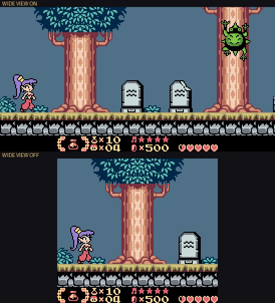
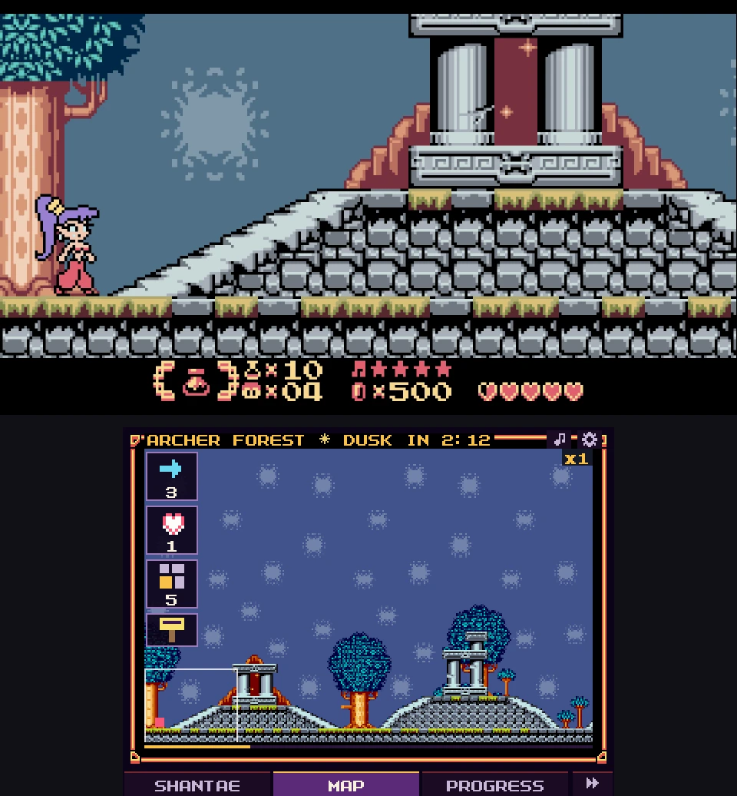
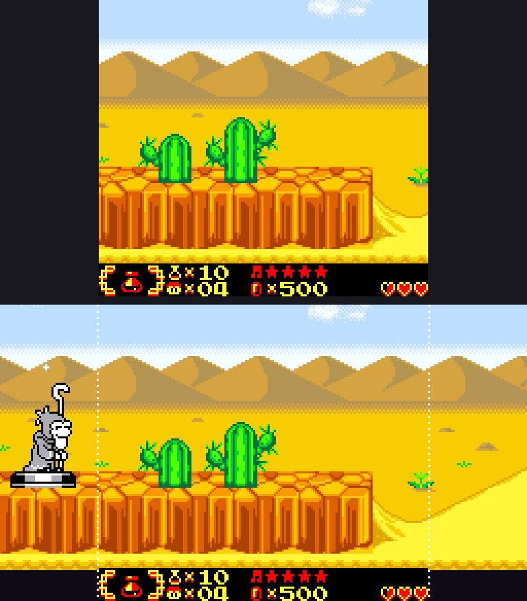
</p>

## Screenshots
Game on the top screen, Link screen below, as on a dual-screen handheld. Rendered from the desktop test build.

<p>
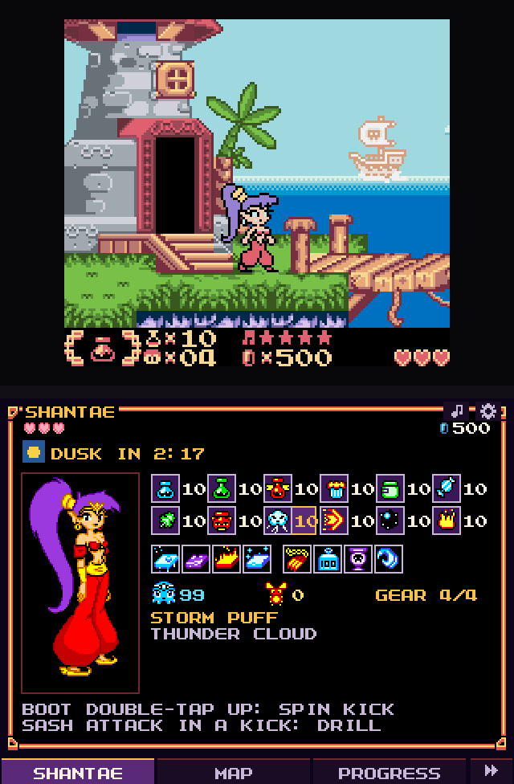
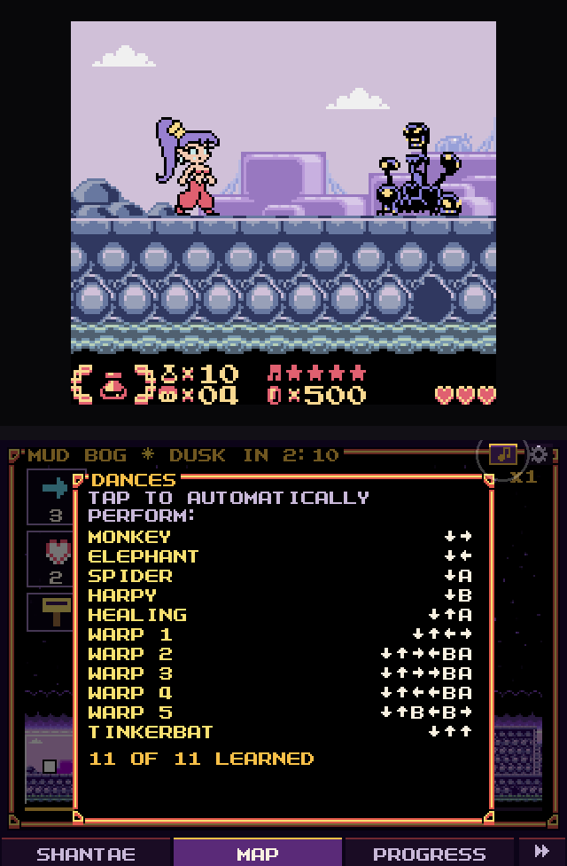
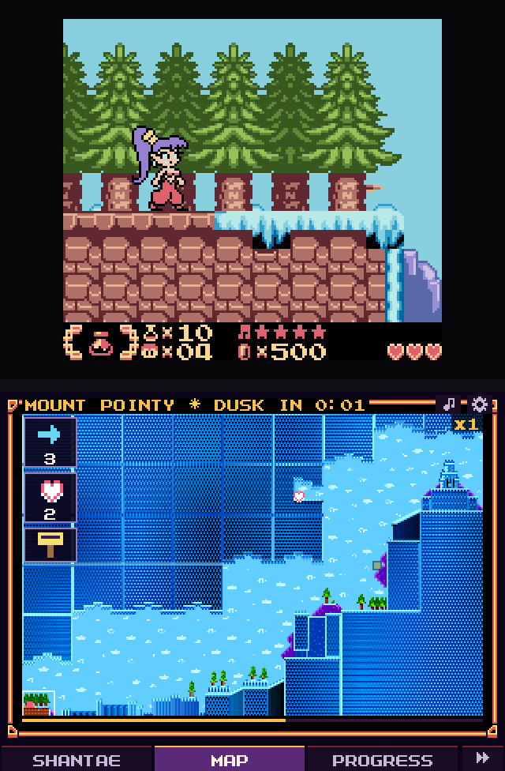
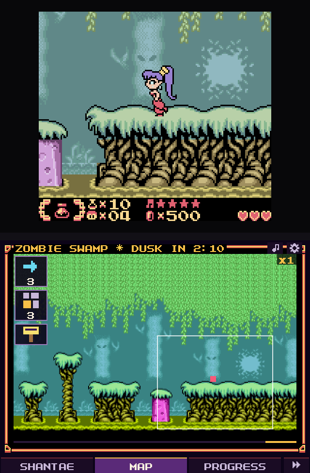
</p>
<p>
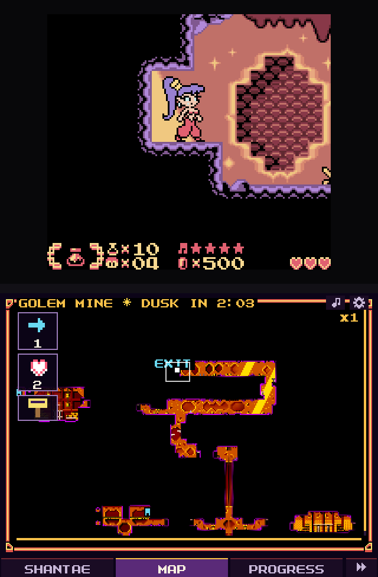
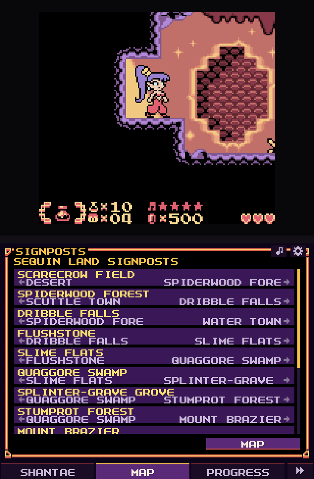
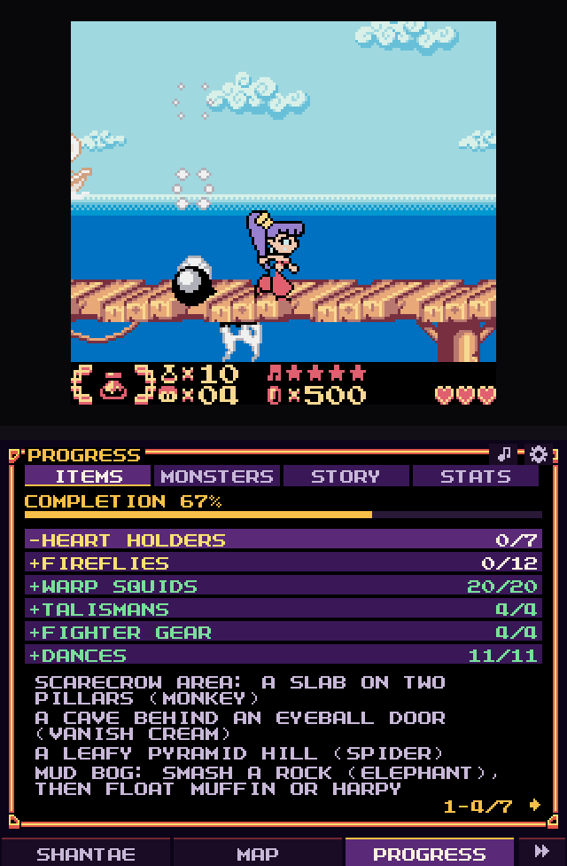
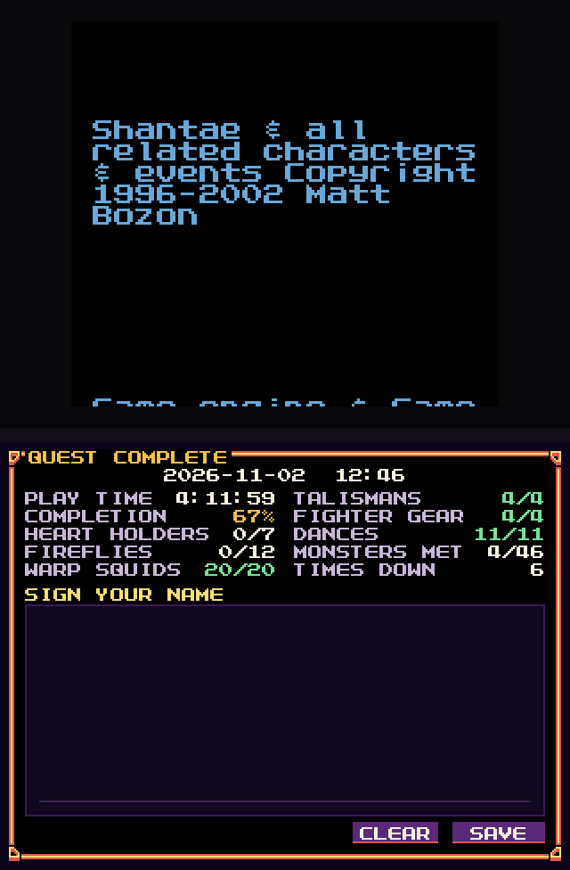
</p>

## AI-assisted?
Feel free to skip over if you feel strongly about it. Claude's `Opus 5.5` was used for ram mapping and initial coding and `Qwen-3-Coding` was used for code review. Code is open-source, feel free to use as a base and human it up.

## Downloads
See [Releases](../../releases). What changed in each version: [CHANGELOG.md](CHANGELOG.md) (Android),
[linkapp/README.md](linkapp/README.md) (Shantae Link) and [native/ctr/README.md](native/ctr/README.md) (3DS).

| File | What it is |
|---|---|
| `Shantae.Dual.<ver>.apk` | Android: emulator + Link screen in one app, with WIDE VIEW |
| `Shantae.Link.<ver>.apk` | Android: Link screen only, reading Shantae running in RetroArch (Gambatte or mGBA core). Works with RetroAchievements (in hardcore mode RetroArch refuses its save state buttons). |
| `Shantae.Dual.3DS.<ver>.cia` | New 3DS / New 2DS: install with FBI |
| `Shantae.Dual.3DS.<ver>.3dsx` | New 3DS / New 2DS: for the Homebrew Launcher (`SD:/3ds/`) |

## Features
- **WIDE VIEW** (Shantae Dual only): the level beyond the Game Boy's edges on wide screens, see above.
- **Link screen:**
  - Live room map from the game's own level data: Shantae's position, heart holders, fireflies, squids and talismans
    (grey once collected). Zoom x1 / x2 / whole region, and drag around.
  - Map cards: where the room leads, a town's doors with their names, what's still to collect here, every room of a
    cave or labyrinth, and the signposts in order.
  - Shantae tab: hearts, gems, time to dusk or dawn, and all 12 items with counts. Tap an item to equip it without
    opening the game's menu. Shantae is drawn in her Fighter's Gear, with pieces you haven't bought shown faint.
  - Dance list: pops up when you press Select, with every dance's inputs. **Auto dance** (Shantae Dual): tap a learned
    dance and the app performs it on the beat, every transformation, Healing and all five Warps.
  - Bestiary: 46 enemies light up the first time you meet them, pictured in the colours of the area you met them in.
    Unmet ones tell you where to look.
  - Progress and story hints: a completion checklist, your place in the story with a hidden hint for the next step,
    and play stats.
  - Day and night: a countdown to dusk or dawn, and a night card (double enemy health, fireflies come out, the Zombie
    Caravan only at night).
  - Boss bars for Risky Boots and the Tinker ship, and an ending card with your run's stats to sign with your finger.
- **Save states:** 4 slots with screenshots (3 on the 3DS), plus quick save/load, an auto state on exit, and the
  game's own battery save.
- **Screens:**
  - Surface Duo hinge, a second display, split screen (side by side / top and bottom with a hinge gap, swappable),
    or one screen with a side panel.
  - **Single screen:** the game fills the screen and an arrow on its edge (or the LINK PANEL button) slides the Link
    screen in over it.
  - 16:9 borders themed from the area's own tiles, changing with day and night, with hearts, gems, lives and the
    clock in them (when WIDE VIEW isn't filling the sides).
- **Controls:** Touch pad support and controller support with rebinding, turbo and fast-forward (also a button on the
  Link screen). Default hotkeys: R1 fast-forward, L1 Link panel, L2 / R2 quick save / load, X / Y turbo B / A.
- **NO SLOWDOWN:** the emulator's overclock (memory accesses at half their cycles), on by default.
- **ALL SPRITES:** draws sprites past the Game Boy's 10 per line, so the Risky Boots fights don't flicker.
- **GBA MODE:** the game's own "GBA ENHANCED" colours and the Tinkerbat transformation.
- **Built from your ROM:** the launcher, pause menu and Link screen use the game's font and frames, and the launcher
  plays the title theme recorded on first start.
- **Experimental 3D view:** level rooms rebuilt in 3D from the live tile map, with ramps, cut-out cards and six
  cameras.
- **Playtest codes:** hidden behind the Konami code on the launcher, off by default, with a room warp to any of the
  game's 68 places.
- **New 3DS / New 2DS:** the same core, Link screen and menus, written in C: the game on the top screen, Link on the
  touch screen, WIDE VIEW across the top screen. Most of the above, but not the 3D view or the Android screen
  layouts; frame skip for an old 3DS (WIDE VIEW needs a New 3DS). See [native/ctr/README.md](native/ctr/README.md).
- **Shantae Link (RetroArch):** the Link screen for Shantae running in RetroArch on the same device, over RetroArch's
  network commands: equip items, open RetroArch's menu, fast-forward, and save or load RetroArch's state slots. Not
  in it: WIDE VIEW and auto dance, which need the emulator. See [linkapp/README.md](linkapp/README.md).

## Source layout
| Path | |
|---|---|
| `app/` | Android app (Java, no AndroidX). `assets/menu` = launcher/pause menu, `assets/link` = Link screen (HTML/JS), `assets/view3d` = 3D view |
| `native/` | gambatte frontend (`gbcore.c`), WIDE VIEW (`wide.c`), JNI layer, first-start capture (`extract.c`), desktop test driver (`drive.c`), `gambatte-dual.patch`. `ctr/` = the New 3DS port (libctru, C) |
| `linkapp/` | Shantae Link for Android (WebView + RetroArch network commands) |
| `tools/` | build scripts, toolchain setup, JNI and log headers, reverse-engineering scripts (`tools/re`) |
| `tests/` | driver, page, menu, WIDE VIEW, 3D view, dance and RetroArch tests, and the release pictures (they need your ROM and local dumps; not included) |
| `docs/` | porting notes, screenshots |
| `out/` | `android/libshantaedual.so`, prebuilt, so the APK builds without rebuilding the core; `libcxx/` config headers |

## Building
Android (no NDK needed; see `tools/setup_toolchain.sh`):
```
bash tools/setup_toolchain.sh      # bionic headers, stub libs, compiler-rt, libc++ 18.1.8 headers, gambatte @ 77f2567 + patch
bash tools/build_apk.sh            # -> out/Shantae Dual <ver>.apk
bash tools/build_link_apk.sh       # -> out/Shantae Link <ver>.apk (no native code)
```
Needs clang, lld, llvm, git, python3, aapt, zipalign, apksigner, dalvik-exchange and openjdk-17, and android.jar
(API 33, from github.com/Sable/android-platforms) at `~/src/platforms/android-33/android.jar` or in `ANDROID_JAR`.
The signing keystores are not in the repo: `build_apk.sh` creates a new one with a random password if
`tools/shantaedual.keystore` is missing (`build_link_apk.sh` the same for `tools/shantaelink.keystore`), with the
password in a `.pass` file beside it. Builds signed with a different key can't update an installed copy.

New 3DS (devkitPro's 3ds-dev: devkitARM and libctru; and ImageMagick):
```
export DEVKITPRO=/opt/devkitpro DEVKITARM=/opt/devkitpro/devkitARM
make -C native/ctr GAMBATTE=$HOME/src/gambatte        # -> out/ctr/Shantae Dual 3DS.3dsx
bash native/ctr/cia/build_cia.sh                      # -> out/ctr/Shantae Dual 3DS.cia
```
`GAMBATTE` is the patched gambatte that `setup_toolchain.sh` checks out. The `.cia` also needs makerom
(3DSGuy/Project_CTR) and bannertool (carstene1ns/3ds-bannertool).

## Credits and licences
This project is licensed under the **GNU General Public License v2.0 or later**, except WIDE VIEW's drawing (below).
If you do use parts of it in your project, please credit me as a "playtester".
The release builds include:
- **libretro-gambatte** (GPL-2.0), github.com/libretro/gambatte-libretro, commit `77f2567`, with
  `native/gambatte-dual.patch` (the NO SLOWDOWN overclock, ALL SPRITES, side-effect-free memory reads, CGB palette
  access, the hook WIDE VIEW reads the game's draw list through, a write/opcode tracer for desktop builds).
- **WIDE VIEW's drawing** in `native/wide.c` is adapted from the Shantae recomp's expanded view,
  github.com/vibecodekun/shantaerecomp, under the **PolyForm Noncommercial License 1.0.0**: Shantae Dual stays
  noncommercial. Its licence text ships in the Dual APK and beside the 3DS files.
- **compiler-rt builtins** (Apache-2.0 with LLVM exception), github.com/llvm/llvm-project, unmodified (Dual APK), and
  **libc++** 18.1.8's headers (same licence), used headers-only.
- **libctru** (zlib), github.com/devkitPro, unmodified, and **newlib** (BSD-style licences), the C library as built by
  devkitARM (3DS).

RAM and ROM addresses were found by tracing and poking the running game in the desktop driver (`native/drive.c`).
The boss health addresses are from TASVideos.
Shantae is a trademark of WayForward Technologies; Shantae (GBC) © Matt Bozon. This is an unofficial fan project and
is not affiliated with WayForward or Capcom.

## RAM / ROM used (Shantae USA)
`C39D` game state (2 playing, 5 dialogue, 0 title and menus), `CBFD` map, `C3E9` time of day (+4 a frame, night from
`8000`), `CB43` / `CB45` Shantae X / Y, `C9FB` / `C9FD` camera, `CA70` 12 item counts, `CA7D` gems, `CA7F` lives,
`CA80` / `CA82` hearts / heart containers (4 units each), `CA84` equipped item, `CA8A` / `CA8B` squids / fireflies,
`CB38` / `CB39` stones / talismans, `CB3A-3B` dances, object nodes in WRAM bank 3 at `D000 + n * 7E` (`+2` script,
`+34` X, `+37` Y), boss health `w3:D15F` (Risky Boots), `w3:D2DA` (Tinker ship), `w3:D64C` (Golem).
ROM (file offsets and bank:address): font `0x3964A3` (LZSS), the level data through the room's screen table
(`C9F9` / `C9FA`), object types `0A:4000`, signpost text `0xA5FE0`, the spawn window `01:506A` (widened by WIDE VIEW),
the sprite list `00:1DC6` and the scroll commit `00:0A57` (read by WIDE VIEW).
Everything the apps read, and how each address was found: [SHANTAE-RAM.md](SHANTAE-RAM.md).
